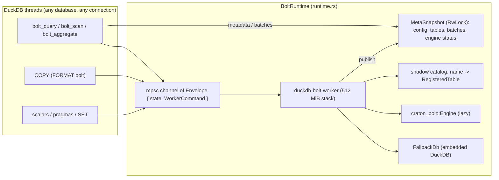

# Craton Bolt DuckDB Extension — Architecture

This document describes the internal architecture of `duckdb-bolt-extension`, developed by [Craton Software Company](https://craton.com.ar). User-facing behavior is specified in [SQL_REFERENCE.md](SQL_REFERENCE.md).

---

## 1. Crate Layout

A three-crate Cargo workspace targeting DuckDB's C API v2 (`v2.0.0`, `C_STRUCT_UNSTABLE`) via `duckdb-neo`:

| Crate | Path | Output | Purpose |
| :--- | :--- | :--- | :--- |
| `duckdb-bolt-core` | `crates/core` | `rlib` (published to crates.io) | All extension logic. Default workspace member. |
| `duckdb-bolt-extension` | `crates/native` | `cdylib` (`publish = false`) | Loadable entrypoint (`#[duckdb_entrypoint_c_api_v2(extension_name = "bolt", api_version = "2.0.0")]`). |
| `duckdb-bolt-wasm` | `crates/wasm` | `staticlib` | WebAssembly entrypoint, built with `cuda-stub`; the Makefile links it with the `bolt_init_c_api_v2` export. Compiled in CI, not distributed. |

`duckdb-neo`'s `build-extension` (native, wasm) and `build-extension-static` (the core crate's dev-dependency, for in-process tests) features are mutually exclusive, so every Cargo command selects a crate with `-p`; `--workspace` does not build.

Modules of `duckdb-bolt-core` (`crates/core/src`):

| Module | Contents |
| :--- | :--- |
| `runtime.rs` | `BoltRuntime` (process-wide handle), worker thread, request states and timeouts, shadow catalog, metadata snapshot, engine lifecycle, engine guard, type normalization, table-name rules. |
| `runtime/engine_support.rs` | Engine upload helpers (coalescing, Utf8 capacity check) and plan inspection for the guard (`plan_is_null_safe`, `plan_type_hazard`, `plan_may_produce_nulls`, `plan_has_dictionary_lowered_predicate`, `plan_has_narrow_arithmetic`, `plan_schema_of`). |
| `runtime/plan_facts.rs` | Per-column facts the guard derives bottom-up through a Bolt logical plan (`NodeFacts`, `ColumnFact`: may hold NULL, widened integer, integer bound), row bounds (`row_bound`) and the structural "may this input be empty?" test (`may_be_empty`). |
| `runtime/fallback.rs` | `FallbackDb`, the embedded host-fallback DuckDB and its table mirrors. |
| `runtime/sql_text.rs` | SQL tokenizer and the "may this SQL reference table `x` / call Bolt" checks. |
| `arrow_bridge.rs` | Arrow <-> DuckDB conversion over the Arrow C Data Interface; RFC-008 original-type metadata (`OriginalDuckDbType`). |
| `copy_function.rs` | `COPY ... TO / FROM (FORMAT bolt)`. |
| `table_functions.rs` | `bolt_query`, `bolt_sql`, `bolt_scan` (projection / filter pushdown), `bolt_aggregate`, `bolt_tables`, `bolt_pool_stats`, `bolt_metrics`, `bolt_devices`, and the once-per-execution `CALL` forms of the catalog mutations (`CatalogCallFunction`: side effect in the global init). |
| `scalar_functions.rs` | `bolt_register_sql`, `bolt_load_*`, `bolt_drop_table`, `bolt_clear_tables`, `bolt_explain`, `bolt_execution_tier`, `bolt_version`, `bolt_prometheus_metrics`. |
| `options.rs` | `bolt_*` settings, startup-option and cross-database sync (`sync_with_runtime`), PTX cache directory validation. |
| `pragmas.rs` | `bolt_info`, `bolt_reset`, `bolt_clear_tables`, `bolt_request_timeout`. |
| `replacement_scan.rs` | `bolt.<t>` / `'bolt:<t>'` / bare-name replacement scan. |
| `ingest.rs` | Parquet / Arrow IPC loading (local, `file:`, DuckDB VFS URLs), IPC validation, normalization (not on wasm). |
| `sandbox.rs` | `FileAccessPolicy`: DuckDB's `enable_external_access` / `allowed_directories` / `allowed_paths` on canonical paths, opened-handle re-check; on Windows, paths are compared after a per-UTF-16-unit upcase that never folds wider than NTFS's ordinal comparison. |

---

## 2. Runtime: one worker thread per process

`craton_bolt::Engine` allows one active engine per process and has `!Sync` internals, and CUDA driver contexts are bound to the thread that created them, while DuckDB calls the extension from any of its worker threads. `BoltRuntime::global()` (a `OnceLock` singleton shared by every DuckDB database in the process) therefore owns a dedicated OS thread, `duckdb-bolt-worker`, that performs every engine operation.

1. **Thread and stack.** The worker is spawned with the first size in `WORKER_STACK_SIZES` (512 MiB, then 64 MiB, 8 MiB) the platform accepts: craton-bolt 0.9 walks predicate trees recursively (upstream report [007](upstream/craton-bolt-007-deep-predicate-stack-overflow.md)). The reservation is virtual memory. If no thread can be started, the runtime is still created and every request fails with an ordinary error (a panic in a DuckDB callback would invalidate the database). On wasm32 there is no thread: commands run inline on the caller's thread under a mutex.
2. **Commands.** `WorkerCommand::{UpdateConfig, ResetEngine, RegisterTable, DropTable, ClearTables, ExecuteSql, ExecuteSqlHostFallback, ExplainSql, InferSqlSchema, ExecutionTier, Telemetry, BackendIsGpu, VersionInfo, ExecuteWithScratch, InjectPanic}`. Each is wrapped in an `Envelope` with a shared request state and answered on a per-request `sync_channel(1)`.
3. **Request states and timeouts.** A request is `QUEUED`, `RUNNING`, `ABANDONED` or `DONE`. `PRAGMA bolt_request_timeout(ms)` (process-wide, `0` = wait forever) bounds the caller's wait: on timeout a still-queued request is marked `ABANDONED` and skipped by the worker; a running mutation (`UpdateConfig`, `ResetEngine`, `RegisterTable`, `DropTable`, `ClearTables`) is waited for; a running read fails and, if it is a host-fallback query, that query is interrupted through the fallback connection's interrupt handle. Only the timed-out caller's own request is interrupted; an interrupt that lands after that query ended is cleared before the next request runs. A GPU query cannot be cancelled ([W2-E-005](issues/W2-E-005-bolt-requests-not-interruptible.md)).
4. **Re-entrancy.** A request issued from the worker thread itself (a Bolt function inside a query that runs on the host fallback, possible in static builds that load the extension into the fallback instance too) would wait for itself; it is refused immediately, and `FallbackDb::sync` refuses SQL that visibly calls into Bolt.
5. **Snapshot reads.** After every mutation the worker publishes a `MetaSnapshot`: the config, table summaries, a lower-case name index, `Arc` clones of every table's batches, and the engine status (GPU yes / no / unknown, cached error, fallback reasons). `config()`, `table_info()`, `list_tables()`, `get_table_batches*()`, `telemetry()` (once the backend is known), `backend_is_gpu()`, `metrics()` and `devices()` are answered on the caller's thread, so bind-time lookups, unfiltered scans, `bolt_tables()` and `bolt_pool_stats()` never queue behind a running query.
6. **Panic isolation.** Each command runs under `catch_unwind`. A panic drops the reply sender (the caller gets an error) and `recover_after_panic` discards the engine and the fallback database and republishes the snapshot; the recovery runs under its own `catch_unwind`, with a minimal second attempt. The host-side catalog is kept: it is mutated only after fallible engine calls succeed.

---

## 3. Catalog and engine lifecycle

1. **Shadow catalog.** `RegisteredTable { schema, batches, num_rows, bytes_in_memory, null_count, column_nulls, generation, utf8_distinct, int_abs_max }`. Batches are stored as registered (no concatenation), normalized to the Bolt storage types on the caller's thread (`normalize_schema_for_bolt`, checked casts, field metadata kept). Registration is one worker command, so it is atomic. `__bolt_`-prefixed names and empty or duplicate column names are rejected. Appends are coerced by column name and checked against the RFC-008 original types.
2. **Lazy engine.** The engine is built on first use from `BoltConfig { device, memory_budget, ptx_cache_dir, enable_tracing }`, and every catalog table is uploaded. A failed build is cached (`engine_init_failed`) until a configuration change or `PRAGMA bolt_reset`, so GPU-less hosts do not retry CUDA on every call. The first successful device ordinal is latched: craton-bolt 0.9 cannot switch GPUs in a process.
3. **Upload coalescing.** craton-bolt keeps one batch per table and re-concatenates the table on every `register_batch`, so the extension coalesces a table's batches into one `register_table` / `replace_table` call and coalesces each append into one `register_batch` ([craton-bolt-008](upstream/craton-bolt-008-register-batch-quadratic.md)). The catalog then replaces its own batches by zero-copy slices of the engine's copy (`share_engine_copy`), so the host holds one copy.
4. **Upload admission.** A table is not uploaded, and is recorded in `engine_upload_errors`, when its upload would bring the engine-resident Arrow bytes above `bolt_memory_budget`, when one of its columns holds more than `MAX_ENGINE_UTF8_BYTES` (2 GiB) of strings, or when the engine rejects it. Such tables are served by the host fallback; the reason shows in `bolt_explain` of a query that names them. An upload failure never fails the registration, so the catalog behaves the same on every backend.
5. **Drops.** craton-bolt 0.9 cannot unregister a table ([W1-B-006](issues/W1-B-006-engine-per-table-unregister.md), [craton-bolt-009](upstream/craton-bolt-009-no-public-unregister-table.md)), so a dropped table is replaced by an empty batch (a *tombstone*). The engine is rebuilt lazily only when a query may reference a tombstone or more than 128 accumulate.
6. **Scratch table.** `execute_sql_with_scratch_table` uploads a batch as the engine-only table `__bolt_scratch` (never in the catalog), runs one query, and empties it again in the same worker round trip. `bolt_scan` uses it for filter-take.
7. **Configuration.** `SET bolt_*` sends `UpdateConfig`; an unchanged value is a no-op, any change drops the engine and clears the cached failure. `PRAGMA bolt_reset` rebuilds eagerly and fails when a CUDA device is visible but no engine can be built. Before each build the PTX cache directory is re-validated (`options::check_ptx_cache_dir_in_use`); a failing directory is not used, and an empty option clears craton-bolt's process-wide cache override and validates `BOLT_PTX_CACHE_DIR`.

---

## 4. GPU engine guard and host fallback

`gpu_crash_guard(sql)` runs before a query is sent to the engine (`ExecuteSql`, `ExecuteWithScratch`, and for `ExplainSql` / `ExecutionTier` reporting). A table counts as referenced when the SQL text may name it (`SqlNames::may_reference`: a whole-word match for plain names, a substring match for names that can only be written quoted). The guard returns a reason to use the host fallback, checking in this order:

1. the query references a table in `engine_upload_errors`;
2. it has more than `MAX_GPU_PREDICATE_TERMS` (4,096) `AND` / `OR` keywords;
3. the guard's Bolt planner cannot plan it: craton-bolt would run such shapes (`WITH RECURSIVE`, `LATERAL`, correlated subqueries, `VALUES`, `generate_series`, `DISTINCT ON`, ...) as host-orchestrated GPU sub-plans with every hazard below, so the guard fails closed (W8-B-003);
4. a referenced table has more than `MAX_GPU_DICTIONARY_LOWERED_VALUES` (4,096) distinct strings in a column and the plan has a `LIKE` / string-ordering predicate (lowered to one `OR` term per dictionary entry);
5. a *type hazard* (`plan_type_hazard`, checked on the plan before and after the optimizer, so constant folding cannot hide one), whatever the NULLs: a `CAST` from or to `DECIMAL` or arithmetic on `DECIMAL`; arithmetic on a widened integer column (`TINYINT`, `SMALLINT`, unsigned, `HUGEINT`) or on `FLOAT`; integer `/` and `%`; arithmetic with a fractional literal next to a non-float operand; `TIMESTAMP - TIMESTAMP`; an ungrouped `count(*)` next to `SUM` of an `INTEGER` column; an ungrouped `SUM` / `MIN` / `MAX` / `STDDEV_POP` over an input that may be empty (`may_be_empty`); `SUM` of `FLOAT`; and an integer `SUM` / `AVG` whose bound (`ColumnFact::abs_max` times `row_bound`) may leave `i64`;
6. a referenced table (or the scratch table) holds NULLs and the plan is not null-safe (`plan_is_null_safe`): plain scans, projections of columns and literals, sorts on plain keys, `LIMIT`, `DISTINCT`, `UNION ALL`, inner / cross equi-joins without a join filter, and `COUNT` / `SUM` / `MIN` / `MAX` / `AVG` of plain columns grouped by plain columns are safe, except a grouped `SUM` / `MIN` / `MAX` of a column that may hold NULLs, a `NULLS FIRST` sort key (the engine's default for ascending keys) over such a column, and an aggregate of such a column whose input is not the scan itself (below a `Sort`, `Limit` or `Distinct`, W9-A-003). Whether a column may hold NULLs is tracked through the plan by position (`NodeFacts`), so aliases, `UNION` branches and `NULL` literals cannot hide one. Filters, windows, set operations other than `UNION ALL`, outer joins and subquery expressions are unsafe ([W2-A-001](issues/W2-A-001-gpu-ignores-null-validity.md));
7. with no stored NULLs, the SQL has a keyword that can introduce one (`LEFT`, `RIGHT`, `FULL`, `OUTER`, `CASE`, `NULL`, `NULLIF`), the plan can produce NULLs itself (`plan_may_produce_nulls`) and it is not null-safe.

Engine errors are retried on the host fallback too (a CUDA error also drops the engine for a lazy rebuild); if the host fails as well, both errors are reported.

**`FallbackDb`** is a long-lived embedded DuckDB opened with `enable_external_access=false`, `autoload_known_extensions=false`, `autoinstall_known_extensions=false`, `allow_community_extensions=false`, `threads` = half the cores (1..4), `memory_limit=25%`, then `lock_configuration=true`. It accepts exactly one `SELECT`. Before each query, mirrors whose catalog `generation` changed are dropped and every catalog table the SQL names is mirrored (`CREATE TABLE` + `INSERT` from an attached Arrow collection, storage types). A table with widened integer columns that a query does arithmetic on is copied once with the original types into schema `__bolt_mirror_base`, and its name becomes a view that shows either those types or the storage types, so switching between the two kinds of query copies nothing. Mirrors not used by the current query are dropped once they exceed 256 MiB in total. Results are read through DuckDB's Arrow stream and cast, with overflow checks, to the Bolt storage types of the bound result types, batch by batch; empty batches are dropped and the remaining batches are passed to the table functions as they are.

`bolt_execution_tier` never executes: no engine or a routed query -> `"Host"` (if the fallback can bind it; host-orchestrated shapes are routed by rule 3); otherwise the planner's tier (`"Gpu"`, `"Hybrid"` or `"Host"`). `bolt_explain` prefixes the GPU plan with the routing reason, or explains with DuckDB when only the fallback can run the query.

---

## 5. Arrow bridge and RFC-008 types (`arrow_bridge.rs`)

- **DuckDB -> Arrow** (`COPY ... TO`, host-fallback results): DuckDB chunks are exported with `ArrowExporter` / `ArrowQueryResult::to_arrow_stream` into `FFI_ArrowArray` / `FFI_ArrowSchema` / `FFI_ArrowArrayStream` and imported with `arrow_array::ffi::from_ffi` / `ArrowArrayStreamReader`. Imported buffers are aligned and validated (`align_buffers`, `validate`) before use, and panics during stream import are caught. Columns whose layout matches the storage type keep their buffers; others are cast with checked casts.
- **Arrow -> DuckDB** (`bolt_query`, `bolt_scan`, `COPY ... FROM`): `write_record_batch_slice_to_chunk_zero_copy` exports a slice with `to_ffi`, imports it with `ArrowImporter::append_consumed`, and references the ref-counted buffers from the output vectors (`Vector::reference`); columns that need a conversion use a per-column writer. Output chunks are sized from the chunk's capacity (at most 2,048 rows).
- **128-bit values**: DuckDB aligns `hugeint_t` buffers (`HUGEINT`, `DECIMAL(19..38, s)`) to 8 bytes, Rust's `i128` needs 16; the bridge uses `read_unaligned` / `write_unaligned` with bounds from the vector length (`// SAFETY:` comments).
- **RFC-008**: `OriginalDuckDbType` lists the storable DuckDB types with their metadata text, storage type and exact Arrow type. `COPY ... TO` and `bolt_load_*` record the original type under the field metadata key `duckdb.logical_type`; `arrow_field_to_duckdb_type` declares it on the read side, `restore_column_to_original_type` / `original_types_schema` convert storage values back (checked), and `COPY ... FROM` converts to the destination's exact types (time-zone-dependent casts by DuckDB under the session `TimeZone`). Metadata inconsistent with the field's Arrow type is ignored.

---

## 6. `bolt_scan` and the replacement scan (`table_functions.rs`)

1. **Bind**: the table is resolved from the snapshot; columns are declared with their original types (unique, case-insensitive names). The bind schema keeps the storage types that pushed SQL refers to.
2. **Projection**: `ScanProjection` deduplicates the requested column indices (`unique`) and maps each output slot to its position (`positions`; virtual row-id columns become all-NULL).
3. **Filter pushdown** (only when the GPU backend is active, probed once per `BoltConfig`): each DuckDB filter is translated exactly when the engine evaluates it like DuckDB (see the table in [SQL_REFERENCE.md](SQL_REFERENCE.md#bolt_scantable_name-varchar)), or as a superset pre-filter (`BETWEEN`) that DuckDB re-applies. Nullable columns get `IS NOT NULL` guards (`LIKE '%'` for Utf8). Utf8 dictionary predicates need at most 64 distinct values, a scan pushes at most 128 terms, `IN` lists at most 64 items. Candidates are validated with one engine `EXPLAIN` (one per predicate on rejection). Literals are written so DuckDB's and the engine's dialects read them the same (exponent floats, integer bounds instead of DECIMAL literals).
4. **Init**: the table must still have the bind-time schema (names, storage and original types), else the scan fails ("dropped or replaced after the query was bound"). Without filters the snapshot batches are streamed directly (restored columns cached per stored column). With filters: select the projected columns on the engine when none of them holds NULLs; else filter-take (referenced columns + `__bolt_row_id` on the scratch table, rows gathered with `take` in insertion order); else the host fallback. Results are converted to the declared types.
5. **Output**: `ChunkedResult` splits the batches into chunks, claimed with one atomic increment per `exec`, so DuckDB scans in parallel (up to 64 threads, about 16 chunks per thread); the chunk index is reported as partition data to keep insertion order.

The replacement scan rewrites `bolt.<t>`, `bolt.main.<t>`, `'bolt:<t>'` and `'bolt://<t>'` to `bolt_scan('<t>')` (any other qualifier, such as `bolt.other.<t>` or `mydb.bolt.<t>`, is left to DuckDB and its catalog error), and an unqualified name only when DuckDB did not resolve it and it matches a Bolt table exactly or case-insensitively.

---

## 7. Options and settings sync (`options.rs`)

The four `bolt_*` options are registered GLOBAL-only with the runtime's current value as their default (so a second database shows what the shared runtime uses). The update callback validates, applies through `BoltRuntime::update_config` (serialized), and returns the normalized value; a refused value leaves the setting unchanged. Every Bolt entry point (scalar `exec`, table-function and COPY `bind`, pragma) first calls `sync_with_runtime`: a lock-free check that the database's settings match the runtime; on mismatch it applies startup-option values through the callback or refreshes values another database made stale (DuckDB 2.0 refuses a `bolt_*` option passed when a database is opened, before the extension has registered it, so in practice the slow path refreshes stale values; `tests/w10a_lock_startup.rs`), and it re-validates the active PTX cache directory (one `stat` while its fingerprint is unchanged, a full check at most every 5 s), disabling the cache and failing the call if it became unsafe.
